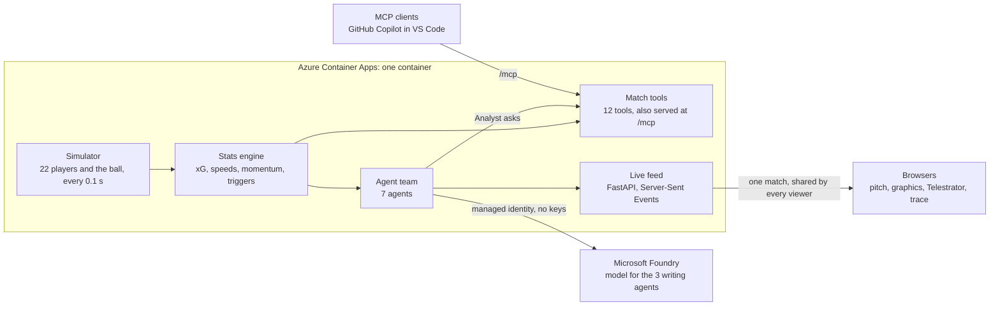
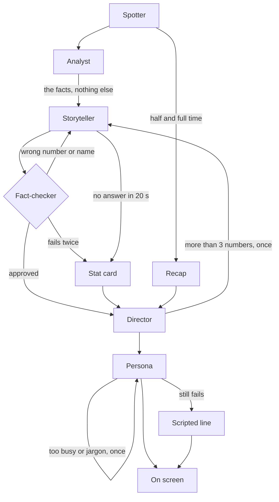

# Second Half

A live AI studio team for a synthetic football match. A simulator plays a
made-up match, a stats engine turns it into numbers, and a team of agents
decides what matters, explains it, fact-checks itself and puts graphics on
screen, tuned to each viewer (Analyst, Casual fan, Player focus, Favourite
club, English or Spanish).

Built for the Microsoft *Inside the Game* developer hackathon with Microsoft
Foundry, Microsoft Agent Framework, the Model Context Protocol and Azure
Container Apps. All clubs, players and matches are fictional.

**[Live demo](https://second-half.niceground-c6cb8283.germanywestcentral.azurecontainerapps.io)**
· [with a guest and the demo switch on](https://second-half.niceground-c6cb8283.germanywestcentral.azurecontainerapps.io/?guest=1&plant=1&seed=17)
· [Analysis view](https://second-half.niceground-c6cb8283.germanywestcentral.azurecontainerapps.io/?view=analysis&plant=1&seed=17)
· MCP endpoint: the live demo address plus `/mcp`


## Quickstart

You need Python 3.11+ and, for the browser view, Node.js 20.19+ (or 22.12+).
On Windows, use `py` where these commands say `python`.

```bash
python -m pip install -r requirements.txt

# build the web app once (and again after pulling changes to web/)
cd web
npm install
npm run build
cd ..

# start the server, then open http://127.0.0.1:8000
python -m api
```

The page starts Harbourside Athletic v Kingsmere Rovers (seed 9: a
second-half comeback with a stoppage-time winner) at 10x speed. To pick
other clubs, a seed and a speed, open the **Match** button at the top and
press **Kick off**.

The page has two views, switched at the top.

**Watch** is the living room: the match as a TV broadcast, seen through a
tilted main camera. While the match plays, the agent team puts graphics on
screen: goal, chance and pass cards, momentum swings, top-speed tags and
half-time and full-time recaps. Moments with a Telestrator drawing replay the
move on the pitch with the arrows drawn in as the ball travels. Click **You**
at the top right to switch the viewer mode (Analyst, Casual fan, Player
focus), the language (English, Español) and pick a favourite club; the line
under those buttons says what the option you are on does. A casual fan's
graphics leave out the stat chips and the xG label too, so their screen
carries one number at most. Press **+** to add a second viewer: the guest's
screen opens in the corner with their own mode, language and club (by
default a Spanish-speaking casual Kingsmere fan). The strip along the bottom,
**Behind this graphic**, shows the relay of agents that made the graphic on
screen, with any wrong number the Fact-checker caught struck through next to
the right one. Watch is laid out for a 1920x1080 screen recording.

**Analysis** is the gallery behind the broadcast, with all the data. How the
match has swung: momentum every minute, with every moment the Spotter flagged
on a rail underneath; pick one, or follow live. The programme monitor sits
next to each agent's desk for that moment: the Analyst's tool calls, each
draft with the caught numbers marked, the Fact-checker's verdict and how long
each step took. Below are the move as the Telestrator drew it with all six
versions the viewers could get, the rundown of every moment with running
totals, the team numbers and the match feed. Hover over (or tab to) any
control, stat, agent name or total with a dotted underline for a
one-sentence note on what it is.


No Azure account or API key is needed: unless you set up Microsoft Foundry
(below), the agents run on a built-in mock model that writes from templates
and deliberately slips a wrong number into some first drafts (always
including the first goal's), so you can watch the Fact-checker catch it.

A real model rarely gets a number wrong, so a demo can't count on a catch.
Tick **Plant a slip** before kick off and a demo switch changes one number
in the first story and in every goal's first draft before fact-checking.
Both views mark each one as planted, so the catch on screen is never
passed off as the model's own mistake.

You can link straight to a set-up, which is handy for demos:
`http://127.0.0.1:8000/?seed=12&speed=20&mode=casual&lang=es&fav=HOME&view=analysis`,
or `http://127.0.0.1:8000/?guest=1&plant=1` for the living room with a guest
and the demo switch on.

**Working on the web app?** Run `python -m api` in one terminal and
`npm run dev` inside `web/` in another, then open http://localhost:5173.
Changes reload instantly.

## Running the agents on Microsoft Foundry

The Storyteller, Persona and Recap agents can write with a real model
deployed in [Microsoft Foundry](https://ai.azure.com). Sign-in uses
Microsoft Entra ID, so there are no API keys to keep.

1. In the Foundry portal, create a project and deploy a model, for example
   `gpt-5.4-mini` (Global Standard). Creating the project in the portal
   gives you the **Foundry User** role, which is what the app needs.
2. Install the [Azure CLI](https://learn.microsoft.com/cli/azure/install-azure-cli)
   and run `az login`.
3. Copy `.env.example` to `.env` and fill in the project endpoint (from the
   project's overview page) and the deployment name:

   ```bash
   FOUNDRY_PROJECT_ENDPOINT=https://<resource>.services.ai.azure.com/api/projects/<project>
   FOUNDRY_MODEL=gpt-5.4-mini
   ```

4. Check it works on the first half hour of a match, then start the server
   as usual:

   ```bash
   python -m agents --model foundry --until 30 --trace
   python -m api
   ```

The Rundown in the Analysis view shows which model is writing (the chip next to its title).
Models from the gpt-5 family think before they answer; the app asks for
`low` effort by default. For the quickest lines set
`FOUNDRY_REASONING_EFFORT=minimal` (gpt-5, gpt-5-mini, gpt-5-nano) or
`none` (gpt-5.1 and later). For a model without reasoning, leave it empty
(`FOUNDRY_REASONING_EFFORT=`).

Live TV can't wait for a slow model, so every call has a 20-second limit.
If the model doesn't answer, the Storyteller's moment goes out as a plain
stat card, and a Persona or Recap version falls back to the scripted line
built from the same facts. Minor moments the team only reaches after 25
seconds are dropped. All of this shows up in the Analysis view.

## Command line

No extra packages needed for these.

```bash
# full match in a few seconds: score and team stats
python -m simulator summary --seed 9

# watch the events scroll by, 20x faster than real time
python -m simulator live --seed 9 --speed 20 --pretty

# raw JSON lines, the format the rest of the system consumes
python -m simulator live --seed 9 --speed 50

# save a whole match (events + player positions) to JSON
python -m simulator export --seed 9

# run the stats engine over a match: xG, field tilt, PPDA, key-moment triggers
python -m stats --seed 9

# run a match through the agent team and print what it put on screen
python -m agents --seed 9
python -m agents --seed 9 --trace              # every handoff, rejected drafts marked x
python -m agents --seed 9 --mode casual --lang es
python -m agents --model foundry --until 30    # on Microsoft Foundry (see above), first 30 minutes
python -m agents --model foundry --plant --trace  # with the demo switch: planted slips, caught
```

Clubs: `harbourside`, `kingsmere`, `ashford`, `northgate` (`--home`,
`--away`). The same seed always replays the same match.

## How it fits together



### Simulator (`simulator/`)

- Four fictional clubs, each with 16 players (pace, passing, finishing,
  stamina, pressing, defending, dribbling, goalkeeping) and a style: high
  press, possession or counter-attack.
- Ticks every 0.1 s: all 22 players and the ball have real positions, so
  speeds, distances and Telestrator drawings come from actual geometry.
- Players weigh passing, carrying, shooting and clearing against the risk
  of losing the ball. Defenders press, cover, mark and get goal-side;
  attackers stay onside. Loose balls are chased, not teleported.
- Events: pass, carry, shot, goal, save, block, tackle, interception,
  clearance, foul (with cards), pressure, out of play (throw-in, goal kick,
  corner), possession change, substitution, kickoff, half time, full time.
- Fatigue, confidence, the score and the clock change behaviour.
- Averages over many matches: about 2.2 goals, 15 shots, 76% pass
  completion, 30 throw-ins, 6 corners, 35 fouls and 11 km per outfield player.

### Stats engine (`stats/`)

Plain code, no AI: every number an agent says later is checked against it.

- **xG** for every shot from distance, angle, body part, situation and
  pressure. Over many simulated matches xG tracks actual goals.
- **Pass difficulty** (0 to 1) from distance, pressure on the passer, how
  open the lane was and how much space the receiver had.
- **Speeds and running** from positions: top speed, distance, sprints.
- **Control vs Chaos** index (0 to 100) from pass completion, possession
  length, turnovers and duels over the last 5 minutes.
- **Momentum** (-100 to 100), field tilt, PPDA and high turnovers.
- **Triggers** with a priority for the Spotter agent: goal, big chance,
  momentum swing, shot over 100 km/h, killer pass, fastest sprint of the
  match, 10 km covered.

### Agent team (`agents/`)

Seven agents work each key moment in turn:

| Agent | Job |
| --- | --- |
| Spotter | Watches the stats engine's triggers, merges ones that belong together (a shot and its goal) and holds back minor moments so the screen isn't cluttered. |
| Analyst | Looks up the facts with the match tools: the passage of play, xG, speeds, the player's and team's numbers. |
| Storyteller | Writes one or two sentences on why the moment matters, using only those facts. |
| Fact-checker | Plain code, no AI. Every number and player name in the draft must match match state. If not, it sends the draft back with the reason; after two failures (or if the model doesn't answer) a plain stat card goes out instead. |
| Director | Sends a story with more than 3 numbers back once, picks the graphics plugin and slot, builds the Telestrator drawing from real event positions, and schedules items so graphics never pile up. |
| Persona | Rewrites the approved story for each viewer mode and language, all at once. Each version is fact-checked again; one that is too busy, or uses jargon like xG for a casual fan, gets one redraft; one that still fails falls back to a scripted line built from the facts. |
| Recap | Writes the half-time and full-time summaries with player ratings. |

Every moment goes down this path, and each check that sends work back has a
fallback if the redraft fails too:



The agents talk to a model through one small interface
(`agents/models.py`). With Foundry configured, the Storyteller, Persona and
Recap each run as a [Microsoft Agent Framework](https://learn.microsoft.com/agent-framework/)
agent on a shared Foundry chat client (`agents/foundry.py`); otherwise
they use the mock model. The other four agents are plain code. The
prompts are in `agents/prompts/`.

**Match tools (`mcp_server/`).** What the Analyst and Recap agents can ask
about the match: score, team and player stats, the sequence that led to an
event, trends, comparisons, top players and the graphics plugins
available. The MCP server below exposes the same tools to any MCP client.

**Graphics plugins (`plugins/`).** Every graphic is a plugin with a
manifest saying which stats it needs, which slot it uses (lower third,
corner, pitch, full screen) and how long it stays up. The Director chooses
from these; the browser draws them (`web/src/plugins/`).

Plugins from outside authors run in a sandbox: a locked-down iframe with
no access to the page and no network, which only receives the data it
asked for. `plugins/xg-race/` is an example from a made-up outside studio,
Touchline Labs: a chart of each team's running xG that the Director picks
for momentum swings. [docs/plugins.md](docs/plugins.md) explains how to
write one.

### Live feed (`api/`)

`GET /api/live?home=harbourside&away=kingsmere&seed=9&speed=10` streams
Server-Sent Events: `meta` (team sheets), `frame` (positions, about 12 a
second), `event` (with computed stats attached), `trigger`, `stats` (a
snapshot every second), `overlay` (a graphic the Director scheduled),
`trace` (one agent handoff) and `end`. A viewer who joins late also gets
`history` (the momentum every minute so far). Viewers of the same match share
one running match and one agent team.

The data formats are documented in [docs/schema.md](docs/schema.md).

### MCP server (`mcp_server/`)

The live server also speaks the [Model Context Protocol](https://modelcontextprotocol.io)
at `http://127.0.0.1:8000/mcp` (Streamable HTTP), so any MCP client
(GitHub Copilot in VS Code, Claude, a Foundry agent) can ask about the
match people are watching. It has 12 tools: `list_matches`, `get_score`,
`get_team_stats`, `get_player_stats`, `compare_players`, `top_players`,
`get_recent_events`, `get_sequence`, `get_trend`, `get_xg_race`, `get_on_screen` (what the
agent team has shown, with its fact-checked stories) and `list_plugins`.
Leave out `match_id` to ask about the match that started most recently.

**VS Code:** this repo includes `.vscode/mcp.json`, so with `python -m api`
running and a match open in the browser, start the `second-half` server
from the MCP view and ask Copilot Chat (agent mode) things like "who has
the highest xG so far?" or "how did the last goal come about?".

**Any other client:** point it at `http://127.0.0.1:8000/mcp`, or run a
replay over stdio without the web app (it plays the match to the minute
given, then answers about it):

```bash
python -m mcp_server --seed 9 --minute 60
```

When the server runs under a public host name (for example on Azure
Container Apps), list that name in `MCP_ALLOWED_HOSTS` (comma-separated).
Requests addressed to any other host are refused, which guards against DNS
rebinding.

## Development

```bash
python -m pip install -r requirements-dev.txt
ruff check .
python -m pytest -q
cd web && npm run typecheck
```

CI runs lint, tests and the web build on every push
(`.github/workflows/ci.yml`).

## Deploying to Azure

The public demo runs on Azure Container Apps, with the agents on
Microsoft Foundry:

- `Dockerfile` builds one image with the web app, the API and the MCP
  endpoint.
- When the tests pass on `main`, GitHub Actions publishes that image to
  `ghcr.io/<owner>/<repo>:latest`.
- `infra/main.bicep` creates a Container Apps environment (with a Log
  Analytics workspace for logs) and the app, gives the app a managed
  identity, and grants that identity the Foundry User role on your Foundry
  resource, so there are no keys anywhere.
- `infra/deploy.ps1` fills the template in from your `.env` and deploys it
  to the Foundry resource's resource group.

The first time:

1. Push to `main` and wait for the CI **image** job. Then open the package
   on GitHub (the repository owner's profile > Packages > second-half) and
   make it public under Package settings, so Azure can pull it.
2. With `.env` set up as in [Running the agents on Microsoft
   Foundry](#running-the-agents-on-microsoft-foundry) and the Azure CLI
   signed in, run this from the repository root:

   ```powershell
   powershell -ExecutionPolicy Bypass -File infra\deploy.ps1
   ```

   It prints the app's address; the MCP endpoint is that address plus
   `/mcp`.

After later pushes, run the same command again to roll out the new image.
The app runs as a single replica, because live matches are kept in memory
and shared by every viewer, and stays warm so visitors never wait
(`-MinReplicas 0` lets it sleep when nobody is using it). `/api/health`
shows which commit and model are running.

You can also run the image yourself: `docker build -t second-half .` and
`docker run -p 8000:8000 second-half`.

## Licence

MIT. See [LICENSE](LICENSE).
